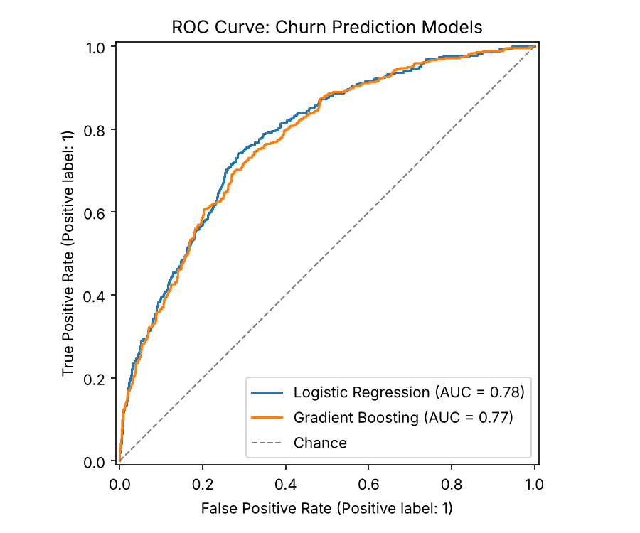
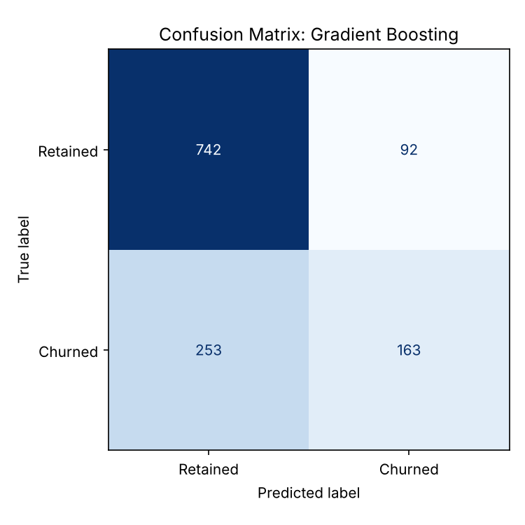

# Churn Analytics (BA/DS Portfolio Project)

A self-contained customer churn analytics project combining a SQL analytics
layer, a scikit-learn predictive model, and a static dashboard — built to
demonstrate end-to-end business analytics skills on a realistic subscription
business problem.

**Status:** research / portfolio project. The dataset is synthetically
generated (not real customer data), with a seeded, believably-noisy
relationship between customer attributes and churn, so every number in this
README comes from an actual run of the code in this repository — not
invented figures.

## Why churn and cohort analytics matter

Subscription and telecom businesses typically spend far more acquiring a
customer than the margin on their first few months of service, so retention
economics dominate profitability. Two analyses recur in nearly every B2C
subscription business:

- **Cohort retention** — tracking how a signup cohort decays over time
  reveals whether retention is improving release-over-release, independent
  of overall growth.
- **Revenue-at-risk segmentation** — not all churn is equal; a segment with
  a high churn *rate* but low revenue contributes less risk than a
  lower-churn but high-ARPU segment. Ranking segments by expected revenue
  loss (not just churn %) is what turns an analysis into a prioritized
  retention roadmap.

This project builds both, plus a predictive model to flag at-risk customers
before they churn, and ties the three together in one dashboard.

## Architecture

```
churn-analytics-ba/
├── data/
│   ├── generate_data.py      # synthetic data generator (seeded)
│   ├── customers.csv         # 5,000-row generated dataset
│   └── churn.db              # SQLite: customers + monthly_activity tables
├── sql/
│   ├── cohort_retention.sql          # retention % by signup cohort x month
│   ├── churn_by_contract_tenure.sql  # churn rate by contract type x tenure
│   ├── revenue_at_risk.sql           # lost + at-risk MRR by segment
│   └── run_queries.py                # executes the .sql files via sqlite3
├── model/
│   ├── train_model.py         # logistic regression vs. gradient boosting
│   ├── metrics.csv, feature_importance.csv, logreg_coefficients.csv
│   ├── roc_curve.png, confusion_matrix.png
│   └── model_summary.json
├── dashboard/
│   ├── build_dashboard_data.py  # pulls real SQL + model results into JSON
│   ├── dashboard_data.json      # the embedded data, standalone
│   └── index.html               # static Chart.js dashboard (no server)
├── requirements.txt
├── LICENSE
└── README.md
```

Data flows one direction, each stage reading the previous stage's real
output: `generate_data.py` → `churn.db` → `sql/*.sql` results → fed into
both the model's feature set (`customers.csv`) and the dashboard's embedded
JSON.

## How to reproduce

```bash
pip install -r requirements.txt

# 1. Generate data (writes data/customers.csv and data/churn.db)
python data/generate_data.py

# 2. Run the SQL analytics layer against churn.db
python sql/run_queries.py

# 3. Train and evaluate the churn models
python model/train_model.py

# 4. Rebuild the dashboard's embedded data and open it
python dashboard/build_dashboard_data.py
# then open dashboard/index.html directly in a browser (no server needed)
```

Full pipeline runs in well under a minute on a laptop (data generation ~1.5s,
SQL queries <1s, model training ~5s).

## Dataset

5,000 synthetic customers generated with a fixed seed (`SEED = 42`) in
`data/generate_data.py`: tenure, contract type, payment method, internet
service, monthly/total charges, usage (GB), support tickets, satisfaction
score, and demographic flags. Churn is simulated from a logistic function of
these features plus Gaussian noise, so it is predictive but **not perfectly
separable** — realistic for this kind of model. Overall churn rate in the
generated sample: **33.3%** (1,666 of 5,000 customers), broadly in line with
published telecom churn benchmarks (~25–35%).

A derived `monthly_activity` table (75,678 rows) reconstructs each
customer's month-by-month activity since signup, enabling cohort-style SQL.

## SQL analytics results

### Churn rate by contract type and tenure bucket

| Contract | Tenure | Customers | Churned | Churn rate |
|---|---|---|---|---|
| Month-to-month | 0-5 mo | 302 | 171 | 56.6% |
| Month-to-month | 6-11 mo | 435 | 238 | 54.7% |
| Month-to-month | 12-23 mo | 1,823 | 798 | 43.8% |
| Month-to-month | 24+ mo | 138 | 42 | 30.4% |
| One year | 0-5 mo | 148 | 52 | 35.1% |
| One year | 6-11 mo | 236 | 66 | 28.0% |
| One year | 12-23 mo | 933 | 202 | 21.7% |
| One year | 24+ mo | 61 | 7 | 11.5% |
| Two year | 0-5 mo | 106 | 16 | 15.1% |
| Two year | 6-11 mo | 171 | 19 | 11.1% |
| Two year | 12-23 mo | 603 | 52 | 8.6% |
| Two year | 24+ mo | 44 | 3 | 6.8% |

Month-to-month customers churn at roughly **5–8x** the rate of two-year
contract customers at every tenure point. Churn risk decays with tenure
within every contract type, but never converges across contract types — new
two-year customers (0-5 mo, 15.1%) already churn less than month-to-month
customers who have stuck around for two years (24+ mo, 30.4%).

### Revenue at risk by segment

| Contract | Internet | Customers | Churn rate | Lost MRR | At-risk MRR (active) | **Total revenue at risk** |
|---|---|---|---|---|---|---|
| Month-to-month | Fiber optic | 1,215 | 53.3% | $50,503 | $23,300 | **$73,803** |
| Month-to-month | DSL | 880 | 42.5% | $24,011 | $13,658 | $37,668 |
| One year | Fiber optic | 599 | 26.5% | $12,109 | $8,907 | $21,015 |
| Month-to-month | No internet | 603 | 37.6% | $12,447 | $7,629 | $20,075 |
| One year | DSL | 481 | 21.4% | $6,590 | $5,124 | $11,714 |
| One year | No internet | 298 | 21.8% | $3,730 | $2,765 | $6,495 |
| Two year | Fiber optic | 399 | 11.0% | $3,391 | $2,968 | $6,359 |
| Two year | DSL | 306 | 8.5% | $1,703 | $1,500 | $3,203 |
| Two year | No internet | 219 | 9.1% | $1,139 | $999 | $2,138 |

("Lost MRR" = monthly charges already walked out the door with churned
customers in this segment; "at-risk MRR" = currently-active customers'
monthly charges weighted by the segment's observed churn rate — an expected
near-term loss, not a certainty.)

**Month-to-month + Fiber optic is the single highest-risk segment**, at
$73,803/month in realized-plus-expected revenue at risk — roughly double the
next segment — despite being only 24% of the customer base. It combines the
worst contract type for retention with the highest-ARPU internet product.

### Retention curve (sample)

Average retention % at key months-since-signup, aggregated across all
signup cohorts (see `sql/cohort_retention.sql` for the full cohort x month
breakdown, 2022-01 through 2025-09):

| Months since signup | Avg. retention |
|---|---|
| 0 | 99.2% |
| 1 | 98.1% |
| 3 | 95.3% |
| 6 | 96.2% |
| 12 | 87.6% |

## Model results

Two models trained on an identical 75/25 train/test split (stratified,
`random_state=42`), 17 one-hot/numeric features, evaluated on the held-out
25% (1,250 customers, 33.3% churn rate):

| Model | Accuracy | Precision | Recall | F1 | ROC-AUC |
|---|---|---|---|---|---|
| Logistic Regression | 0.7288 | 0.6453 | 0.4111 | 0.5022 | **0.7810** |
| Gradient Boosting | 0.7240 | 0.6392 | 0.3918 | 0.4858 | 0.7725 |

Logistic regression edges out gradient boosting here — unsurprising given
churn was simulated as a (noisy) linear-in-logit function of the features.
Both models clear a 0.77+ AUC, meaningfully better than chance, while
leaving plenty of unexplained variance — consistent with how this dataset
was deliberately generated (not perfectly separable).




### Top feature importances (Gradient Boosting)

| Feature | Importance |
|---|---|
| satisfaction_score | 0.2756 |
| contract_type_Two year | 0.1770 |
| contract_type_One year | 0.1073 |
| monthly_charges | 0.0934 |
| support_tickets | 0.0823 |
| avg_monthly_usage_gb | 0.0816 |
| total_charges | 0.0552 |
| tenure_months | 0.0550 |

Satisfaction score and contract type dominate both models' feature
importances / coefficients — consistent with the SQL findings above and
with how the synthetic churn label was constructed.

## Dashboard

`dashboard/index.html` is a static, self-contained page (Chart.js via CDN,
zero backend) that visualizes the retention curve, churn-by-segment bars,
and revenue-at-risk chart above, with the real computed numbers baked in as
an embedded `<script type="application/json">` block
(`dashboard/dashboard_data.json`). Open the file directly in any browser —
no server required. Re-run `python dashboard/build_dashboard_data.py` after
regenerating data to refresh the embedded numbers.

## Business recommendations

Grounded in the SQL and model results above:

1. **Prioritize retention spend on month-to-month + fiber customers.** This
   segment alone accounts for $73,803/month of realized-plus-expected
   revenue at risk — more than the next two segments combined. A targeted
   save offer (e.g., discounted upgrade to a one-year contract) aimed at
   this segment has the largest expected payback.
2. **Push contract upgrades, not just discounts.** Churn rate drops by
   5–8x moving from month-to-month to two-year contracts at every tenure
   level; contract type is the second-strongest predictor in both models.
   An upgrade incentive is likely to outperform a pure price discount.
3. **Treat satisfaction score and support tickets as leading indicators.**
   They are the top two(ish) drivers in the model; a proactive outreach
   trigger on low satisfaction + 2+ tickets in a month would catch risk
   earlier than waiting for a cancellation request.
4. **Tenure matters most in the first 6–12 months.** Retention is highest
   right after signup (99.2% at month 0, consistent by construction) and
   degrades most noticeably in the first year; a structured onboarding /
   early-tenure engagement program is the highest-leverage intervention
   point.

## Future work

- Replace the synthetic generator with a real (anonymized) billing/usage
  extract once available, and re-validate all findings against it.
- Add a proper hazard/survival model (e.g. Cox proportional hazards) for
  tenure-aware churn timing rather than a single binary label.
- Hyperparameter-tune the gradient boosting model (grid/Bayesian search) and
  add SHAP values for per-customer explanations.
- Wire the dashboard to a live query layer (e.g. DuckDB + a small API) so it
  reflects fresh data instead of a baked-in snapshot.
- Add a cost-sensitive threshold analysis (expected retention-offer cost vs.
  expected revenue saved) rather than reporting raw classification metrics.

## License

MIT — see [LICENSE](LICENSE). Copyright (c) 2026 Jai Indra Reddy Jonnala.
